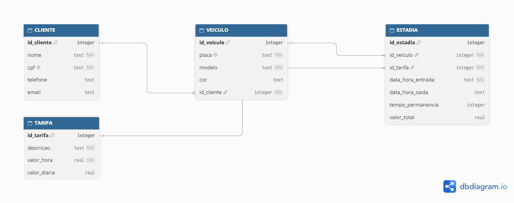

# ParkPag

## 1. Problema que o projeto resolve

Empresas de estacionamento privativo precisam de uma forma confiável e prática de registrar os veículos de seus clientes e calcular o valor final a ser pago. Nem sempre elas possuem capital suficiente para investir em um totem que faça a leitura automática dos horários. É nesse nicho que a ParkPag entra.

O aplicativo ParkPag permite que o negócio cadastre seus clientes e vincule um ou mais veículos a cada um deles. Com base nos horários de entrada e saída informados manualmente pelo usuário da empresa, o valor final a ser pago é calculado automaticamente.

## 2. Público-alvo

Empresas de estacionamento privativo que não possuem capital suficiente para investir em totens automatizados com leitura dos horários de entrada e saída e sistema de cancelas.

## 3. Requisitos do usuário

- **RU01:** O usuário deve poder cadastrar os clientes do estacionamento.
- **RU02:** O usuário deve poder cadastrar um ou mais veículos para cada cliente.
- **RU03:** O usuário deve poder registrar manualmente a data e o horário de entrada de um veículo no estacionamento.
- **RU04:** O usuário deve poder registrar manualmente a data e o horário de saída de um veículo.
- **RU05:** O usuário deve receber o cálculo automático do valor a ser cobrado pela permanência do veículo.
- **RU06:** O usuário deve poder consultar os dados dos clientes e os veículos associados a eles.
- **RU07:** O usuário deve poder consultar o tempo de permanência e o valor calculado para cada estadia.
- **RU08:** O usuário deve poder identificar a qual cliente pertence determinado veículo.
- **RU09:** O usuário deve conseguir utilizar o sistema sem depender de equipamentos automatizados para registrar a entrada e a saída dos veículos.

## 4. Características do Aplicativo

- **Tela Inicial:** Apresenta o aplicativo ParkPag e fornece acesso às principais funcionalidades do sistema.
- **Menu Principal:** Centraliza o acesso às funcionalidades disponíveis no aplicativo, permitindo a navegação entre os módulos.
- **Lista de Clientes:** Permite visualizar e consultar os clientes cadastrados no sistema.
- **Cadastro de Clientes:** Responsável pelo registro das informações dos novos clientes.
- **Detalhes do Cliente:** Exibe os dados completos e as informações associadas ao cliente selecionado.
- **Gerenciamento de Veículos:** Permite cadastrar e consultar os veículos vinculados aos clientes.
- **Registro de Entrada e Saída:** Controla a movimentação dos veículos no estacionamento, registrando horários de entrada e saída.
- **Controle de Pagamentos:** Realiza o registro e a consulta dos valores referentes aos serviços de estacionamento.
- **Histórico de Movimentações:** Disponibiliza a consulta dos registros de estacionamento realizados, permitindo o acompanhamento das movimentações anteriores.

## 5. Modelo Entidade-Relacionamento (ER) do Banco de Dados Local

### Introdução

O banco de dados local do aplicativo ParkPag foi modelado em SQLite e é composto por quatro tabelas: CLIENTE, VEICULO, TARIFA e ESTADIA. O modelo atende aos requisitos funcionais RU01 a RU09 e às exigências mínimas da atividade, conforme o quadro a seguir.

Para mais dúvidas técnicas acesse: [Saiba mais](./docs/docs-modelo-er.md)

### Imagem do Diagrama ER

---

## 9. Tecnologias, bibliotecas e linguagens de programação a ser utilizada

- Ionic - Link de referência: https://ionicframework.com/docs/
- Angular - Link de referência: https://angular.dev/
- TypeScript - Link de referência: https://www.typescriptlang.org/
- Capacitor - Link de referência: https://capacitorjs.com/
- SQLite - Link de referência: https://www.sqlite.org/

## 10. Banco de dados local a ser utilizado e como será implementado

Será utilizado o banco de dados `SQLite` tendo em vista que o aplicativo proposto deverá operar sem conectividade com a internet, e é amplamente utilizada em aplicações móveis por ser leve, não exigir servidor e funcionar localmente no dispositivo.

O método de implementação será em um arquivo físico conhecido como `Disk-based` onde os dados serão salvos em um único arquivo no disco do dispositivo, como database.sqlite ou dados.db. Esta técnica permite manter uma persistência dos dados após a finalização da execução da aplicação e até mesmo a reinicialização do dispositivo.